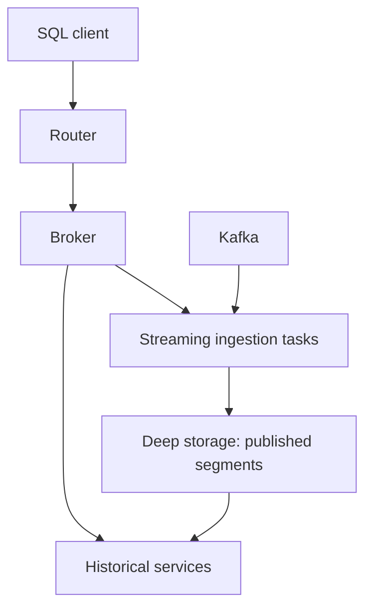

# Apache Druid: Architecture, Query Execution, and Real-Time Analytics

A practical guide for data engineers, using the sales-and-refunds Kafka/Flink lab as an example.

**Reading order:** architecture → event lifecycle → query execution → correctness → workload fit.

**Scope:** the classic Broker/Historical/streaming-task architecture used by our Druid 35.0.0 lab. Newer releases also provide other execution paths. References were checked on October 29, 2026; `latest` documentation can describe features beyond this pinned version. This guide explains behavior and design tradeoffs; it does not claim measured performance for our local environment.

## 1. What Druid does

Druid is a distributed analytical database for querying event-oriented data. A useful workload is: “For the last 15 minutes, show net sales by store, channel, and minute, while new sales keep arriving.”

Three distinct concerns appear in that sentence:

- **Freshness:** how soon a new event becomes queryable.
- **Query latency:** how quickly an analytical request returns.
- **Correctness:** which events and versions the answer includes.

A fast query can return stale data. A fresh result can still include business duplicates. Evaluate all three separately.

## 2. Services and their responsibilities

| Component | Responsibility | Important distinction |
|---|---|---|
| Router | Entry point for UI and routed API requests | Not the main aggregation engine |
| Broker | Plans interactive SQL, selects serving segments, distributes queries, merges results | Not the durable event store |
| Historical | Loads immutable segments and serves queries | Does not accept row-by-row writes |
| Overlord | Manages ingestion supervisors and task execution | Ingestion control, not query aggregation |
| MiddleManager | Starts and manages ingestion task processes | A task host, not a Kafka broker |
| Peon | JVM executing an individual task | A streaming ingestion task can also serve recent data |
| Coordinator | Assigns and balances segments across Historicals | Manages data availability |
| Deep storage | Stores published segment files, commonly in object storage | Durable segment storage, not our lab's interactive query endpoint |
| Metadata database | Stores segment/task metadata and committed ingestion progress | Postgres does not store the sales fact rows |
| ZooKeeper | Supports Druid discovery, coordination, and election | Separate from Kafka's KRaft metadata quorum |

In our Compose environment, Coordinator and Overlord share one container. Logical roles need not imply separate machines. Production deployments can scale ingestion, query coordination, and historical serving separately. [1]



The diagram shows the main data/query relationships; controllers and metadata dependencies are listed in the table.

## 3. Data layout: datasources, time chunks, and segments

A datasource resembles an analytical table. Its primary timestamp is `__time`; our ingestion spec maps `event_time` into it.

A **time chunk** is a partitioning interval. A **segment** holds a portion of data for a time chunk. One hour can contain several segments; an hour is not synonymous with one file.

Published segments are immutable and columnar. Druid can read the columns needed by a query rather than reconstruct every complete event. Supported column encodings and indexes, including dictionaries and bitmap indexes for string dimensions, can reduce filtering work. Index behavior depends on column type and ingestion configuration; “every predicate always uses a bitmap” is not a valid assumption. [2]

Keep these granularities separate:

| Setting/concept | Meaning in our lab |
|---|---|
| `segmentGranularity=HOUR` | Organize segments into hourly time chunks |
| `queryGranularity=NONE` in raw | Do not truncate event timestamps for ingestion rollup |
| `queryGranularity=MINUTE` with rollup | Bucket timestamps for minute-level pre-aggregation |
| `TIME_FLOOR(__time, 'PT1M')` | Group into minutes at query time |

Changing the SQL bucket does not repartition stored segments.

## 4. From Kafka event to Historical segment

The streaming lifecycle is:

1. A supervisor creates Kafka indexing tasks.
2. Tasks read assigned partitions, parse records, and index accepted events.
3. Recent indexed data can be queried from the running tasks, before segment publication.
4. Completed segments are pushed to deep storage and their metadata is published.
5. Historical services load the segments.
6. Streaming tasks complete handoff once Historical serving is available. [4][16][17]

**Task duration is not a minimum data freshness interval.** A ten-minute task does not imply dashboards must wait ten minutes to see new rows.

Nor are these states interchangeable:

| State | What it establishes |
|---|---|
| Producer acknowledged | Kafka accepted the record |
| Indexed by a running task | The record may be queryable through real-time serving |
| Published | Segment metadata and committed progress have been recorded |
| Available on Historical | Historical can serve the published segment |

Durability, availability, and freshness require different checks. Our local deep-storage volume is useful for learning but is not a highly available object store.

## 5. Query walkthrough

Assume `orders_clean` is running. This query asks for a half-open UTC interval, avoiding overlap when adjacent intervals are combined:

```sql
SELECT
  TIME_FLOOR(__time, 'PT1M') AS event_minute,
  store_region,
  currency,
  COUNT(*) AS event_count,
  SUM(amount_cents) AS net_amount_cents
FROM orders_clean
WHERE __time >= TIMESTAMP '2026-10-29 17:00:00'
  AND __time <  TIMESTAMP '2026-10-29 18:00:00'
  AND channel = 'web'
GROUP BY 1, 2, 3
ORDER BY event_minute DESC, store_region, currency;
```

Use a query context containing `"sqlTimeZone": "UTC"`. Replace the example dates with an interval containing your data. `event_minute` avoids the SQL keyword conflict encountered with the alias `minute`.

### 5.1 Parse and plan

For the classic interactive path, the Broker uses Apache Calcite to plan SQL into native Druid queries. SQL is not a request for an external Spark job.

Inspect planning by prefixing the query with:

```sql
EXPLAIN PLAN FOR
```

Look for a bounded native time interval, datasource, filters, dimensions, and aggregators. A predicate on `__time` is especially valuable when translated into native `intervals`. Check the plan rather than assuming every timestamp expression permits efficient pruning. [5]

### 5.2 Select segments and serving replicas

The Broker maintains a timeline of segments and their serving locations. It identifies the segments relevant to the requested interval, and can sometimes prune further based on compatible partitioning and filters.

For replicated data, replicas are alternative serving copies, not independent fact sets to sum. A normal handoff likewise should not count the same logical segment once from a task and again from Historical. Broker routing and the segment timeline manage serving locations. [6]

### 5.3 Filter, read columns, and aggregate locally

The Broker sends work to the data-serving processes. Each relevant segment is filtered and processed locally. Useful filtering indexes can identify matching rows before metric columns are read. Irrelevant columns can be skipped. [7]

For this query, workers produce partial counts and signed monetary sums per `(event_minute, store_region, currency)`. They need not return every underlying order to the Broker.

### 5.4 Merge and finalize

The Broker combines partial results for matching groups. For illustration:

| Serving process | Group | Count | Signed cents |
|---|---|---:|---:|
| Historical A | 17:40, south, PLN | 70 | 120000 |
| Historical B | 17:40, south, PLN | 20 | 30000 |
| Streaming task | 17:40, south, PLN | 10 | -5000 |
| Final result | 17:40, south, PLN | 100 | 145000 |

The numbers are illustrative, not benchmark output.

A distributed average requires combining sums and counts, not averaging worker averages equally. An exact distinct count cannot generally be calculated by adding local distinct counts: an ID may occur on multiple workers.

Native query type affects execution and result streaming. Ordering an aggregate result can require materializing the result before returning it; not every query streams immediately. [8]

## 6. What query “semantics” means in practice

### Segment versions are not global streaming transactions

The Broker selects an appropriate available segment set when a query begins. Replacement uses segment versions to avoid combining superseded and replacement copies of the same data.

Atomic replacement applies **per time chunk**. A rewrite spanning several chunks is not necessarily a simultaneous all-chunks cutover. Do not infer a globally synchronized snapshot across every Kafka partition or continuously changing task. [3]

### Visibility is not finality

Repeated queries can change because new events arrive, old events arrive late, or data is replaced. A returned event-time minute is not automatically a closed window.

A recent row visible on a streaming task can temporarily disappear during task failure and return after replay. Exactly-once publication does not make every observation of uncommitted real-time data an immutable snapshot. [3]

### Successful SQL is not proof of complete data

If segments become unavailable beyond available replicas, queries can cover only the available segments. Monitor availability and ingestion progress alongside SQL success. [3]

Our reconciliation adds count, exact distinct count, and signed-sum evidence. It still needs a defined expected source boundary.

## 7. Rollup changes the meaning of a row

Raw datasources retain individual accepted records. Rolled-up datasources retain aggregate states for matching dimensions and truncated timestamps. High-cardinality fields such as event_id prevent useful aggregation when retained as dimensions.

Suppose an ingestion-time `count` metric named `events` represents source-event counts:

```sql
SELECT
  COUNT(*) AS stored_rows,
  SUM(events) AS represented_events,
  SUM(amount_cents_sum) AS net_amount_cents
FROM orders_minute;
```

`COUNT(*)` counts stored rows. `SUM(events)` counts represented input events. They answer different questions. Streaming rollup can leave the same logical group in multiple segments, so query-time aggregation remains necessary.

Rollup is lossy: discarded event-level detail cannot be recovered from the aggregate alone. Keep raw history separately when audit, debugging, or replay requires it. Rollup also does not remove business duplicates; their values are aggregated too. [9]

## 8. Exactness, ordering, and SQL behavior

For reconciliation through `/druid/v2/sql`, an explicit context can include:

```json
{
  "sqlTimeZone": "UTC",
  "useApproximateCountDistinct": false,
  "useApproximateTopN": false,
  "timeout": 20000
}
```

These settings choose semantics, not free performance improvements. Exact distinct may cost more. Explicit sketch functions such as `APPROX_COUNT_DISTINCT` remain approximate; disabling approximate planning does not convert sketch state back into raw IDs. [10][11]

Without `ORDER BY`, do not rely on output order. For repeatable pagination or tie handling, choose adequate ordering keys. [12]

`COUNT(*)` counts rows, while `COUNT(column)` excludes nulls. Under SQL-compliant null handling, `column <> 'x'` does not include null rows; include `OR column IS NULL` when that is the business requirement. [10][13]

Integer cents avoid floating-point representation error in our event amounts, but totals still require overflow checks. Currency remains part of the grouping: PLN and EUR cannot be summed into a meaningful monetary total without conversion.

## 9. Exactly-once ingestion versus business deduplication

Druid's Kafka ingestion coordinates offsets with segment publication. This protects recovery from treating the same committed source progress as a new independent ingestion. It does not establish uniqueness of event_id values written at different Kafka offsets. [4]

Our lab illustrates the distinction:

| Input/output | One generated file |
|---|---:|
| Original unique business events | 1000 |
| Valid Kafka records, including intentional duplicates | 1100 |
| Malformed records | 3 |
| Raw Druid rows after successful reconciliation | 1100 |
| Intended clean rows through the Flink path | 1000 |

The raw count and sum were confirmed in your local run. The clean figure is the Flink acceptance target; it is not a claim that this entire path has already passed a local cluster test.

Flink validates, deduplicates within its configured 24-hour processing-time TTL, and enriches before writing transactional clean output. Druid reads committed output and performs analytical serving. Source processing, transaction visibility, Druid ingestion, and dashboard refresh each add latency.

## 10. Updates and corrections

Druid does not provide general single-record updates by primary key. A repeated event_id is not an UPSERT. Corrections commonly require a deliberately modeled append-only ledger or replacement of affected time intervals.

This matters with Flink windows: writing a total of 100 and then an updated total of 120 produces 220 under a plain SUM. Define final-only output, valid corrective deltas for additive metrics, or a replacement strategy. The SQL query cannot infer which record supersedes which. [14]

## 11. Why it fits real-time analytics

The following assessment is an engineering interpretation of the mechanisms above, not a benchmark or a guarantee for every workload.

| Workload need | Relevant mechanism | What to validate |
|---|---|---|
| Query new events promptly | Serving from active indexing tasks | Event-to-query latency under load |
| Query history and recent data together | Broker routing to both serving layers | Handoff correctness and availability |
| Filter events interactively | Time pruning, column selection, indexes | Actual plans, selectivity, and scanned data |
| Aggregate large event populations | Local partial aggregation and optional rollup | Cardinality, precision, and retained detail |
| Support independent traffic growth | Separate ingestion and serving roles | Resource isolation and scaling bottlenecks |
| Recover published analytical history | Immutable segments in durable storage | Metadata backups, replicas, and tested restore |

Likely applications include operational sales dashboards, user-facing product analytics, observability event exploration, and telemetry summaries. The common shape is time-filtered aggregation over arriving facts.

Druid is less attractive when the main need is transactional row updates, large join-heavy relational models, or an infrequently queried small dataset that a simpler database already handles well. Classic native joins have execution constraints; SQL syntax alone does not imply warehouse-style distributed join behavior. [5][8]

Complexity is part of the choice: multiple services, task slots, JVM/direct memory, segments, compaction, lag, and availability all need operational ownership.

## 12. What to measure in this project

Measure the independent budgets rather than reporting only SELECT 1 latency:

1. **Freshness:** producer timestamp to query visibility; account for Flink checkpoint commits where used.
2. **Ingestion:** Kafka progress, parse failures, task health, publishing/handoff, and slot pressure.
3. **Serving:** p50/p95 latency for representative queries at realistic concurrency, plus errors and resource usage.
4. **Completeness:** segment availability and reconciliation against a fixed source boundary.
5. **Efficiency:** segments scanned, data volume, cardinality, raw versus rollup storage, and cache conditions.

Druid exposes query, ingestion, and handoff metrics; select monitors/emitters appropriate to the deployment. Metric availability and units matter. The lab's basic probe is not a full native metrics pipeline. [15]

To examine publication versus availability in the UI's SQL view, use the segment metadata table. [18]

```sql
SELECT
  datasource,
  is_published,
  is_available,
  is_realtime,
  COUNT(*) AS segment_count
FROM sys.segments
WHERE datasource IN ('orders_raw', 'orders_clean')
GROUP BY 1, 2, 3, 4;
```

A useful exercise is to reconcile one run before and after handoff, then interrupt a worker and observe freshness, availability, and recovery separately. Wait for ingestion catch-up before interpreting a stable count as proof of completed replay.

## 13. Interview explanation

“Druid separates streaming ingestion, durable segment storage, and analytical serving. New events can be queried from active indexing tasks before they are handed to Historical services. For a classic interactive query, the Broker selects relevant segments, distributes filtering and aggregation, then merges partial results. This suits fresh, time-oriented analytics, provided we define deduplication, rollup, precision, and correction semantics explicitly.”

## References

Official Apache Druid documentation. Links using `latest` should be checked against the deployed release.

1. [Architecture and service responsibilities](https://druid.apache.org/docs/latest/design/architecture/)
2. [Segment structure and indexing](https://druid.apache.org/docs/latest/design/segments/)
3. [Storage, handoff, versioning, availability, and consistency](https://druid.apache.org/docs/latest/design/storage/)
4. [Kafka ingestion and transactional consumption](https://druid.apache.org/docs/latest/ingestion/kafka-ingestion/)
5. [SQL translation and planning](https://druid.apache.org/docs/latest/querying/sql-translation/)
6. [Broker segment timeline and routing](https://druid.apache.org/docs/latest/design/broker/)
7. [Query processing and pruning](https://druid.apache.org/docs/latest/querying/query-processing/)
8. [Native query execution](https://druid.apache.org/docs/latest/querying/query-execution/)
9. [Ingestion-time rollup](https://druid.apache.org/docs/latest/ingestion/rollup/)
10. [SQL aggregate functions](https://druid.apache.org/docs/latest/querying/sql-aggregations/)
11. [SQL query context](https://druid.apache.org/docs/latest/querying/sql-query-context/)
12. [SQL query syntax](https://druid.apache.org/docs/latest/querying/sql/)
13. [SQL-compliant null handling](https://druid.apache.org/docs/latest/release-info/migr-ansi-sql-null.html/)
14. [Data updates and replacement](https://druid.apache.org/docs/latest/data-management/update/)
15. [Operational metrics](https://druid.apache.org/docs/latest/operations/metrics/)

16. [Peon task execution](https://druid.apache.org/docs/latest/design/peons/)
17. [Coordinator segment management](https://druid.apache.org/docs/latest/design/coordinator/)
18. [SQL metadata tables](https://druid.apache.org/docs/latest/querying/sql-metadata-tables/)
