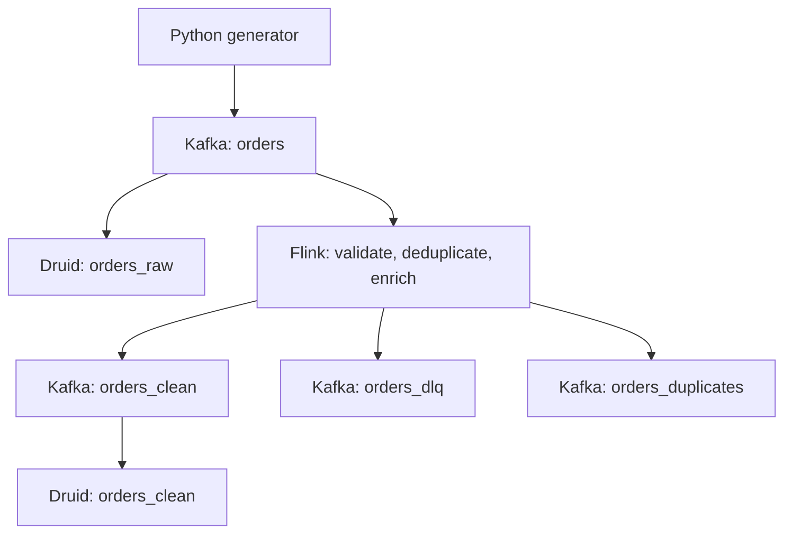

# Flink processing path

The optional Flink profile adds a second path while preserving the original direct Kafka → Druid path.



Flink and PyFlink are pinned to 1.20.1, with Kafka connector 3.3.0-1.20. These are a learning baseline, not the latest versions. PyFlink runs **inside Docker**, using its own Python environment. Keep the host requirements unchanged; do not install PyFlink into the host's Python 3.12 environment. The image installs a Python version supplied by the pinned Flink base image; PyFlink 1.20 supports Python 3.8–3.11.

## Responsibilities and contracts

| Stage | Behavior |
|---|---|
| Kafka source | Reads `orders` from earliest on a new submission; a checkpoint/savepoint restore uses restored offsets |
| Validation | Requires a JSON object, required string fields, valid timezone-aware timestamps, known stores/channels, PL/PLN, schema 1 or 2, and signed 64-bit integer cents |
| Invalid records | Written to `orders_dlq` with reason and original payload |
| Deduplication | Keyed by event_id; remembers the full source-payload fingerprint for 24 hours of processing time |
| Exact duplicate | Not emitted to clean; written to `orders_duplicates` for auditing |
| Conflicting payload | Same ID, different source payload: written to DLQ; the first observed payload remains authoritative within retained state |
| Enrichment | Adds store_city, store_region, enrichment_version, and source_delay_ms from a versioned, in-code store map |
| Clean sink | Emits append-only JSON events to `orders_clean` |
| Druid | Reads only committed transactions and serves SQL over the clean events |

Refunds are negative, sales positive. Numeric strings, floats, booleans, overflow, nonstandard JSON NaN/Infinity, and repeated JSON object keys are rejected. Unknown additive fields are preserved; the Druid ingestion spec explicitly chooses which fields to index. Changing an existing event's ingested_at or any other source field counts as a conflict, even if amount_cents is unchanged. This is an explicit immutable-payload contract, not a universal deduplication policy.

The static store map is deterministic enrichment, not a temporal join, CDC lookup, or external database integration. In a real pipeline, version reference data and define how historical replay should resolve it. First observed means processing order at the keyed operator, not lowest event_time; inputs with the same ID should have consistent upstream partitioning if conflict ordering matters.

## Start the Flink path

Use the existing project root and activated host `.venv`. If the original environment is not running:

```bash
docker compose up -d
python -m lab.cli wait --timeout 300
```

Create the four topics, build the Flink image, and start the cluster:

```bash
python -m lab.cli bootstrap --flink
make flink-up
```

The first build downloads PyFlink, Python dependencies, and the shaded Kafka connector, so it can take several minutes and needs internet access. Allow roughly 3–4 GiB of additional RAM for the Flink services and Python processes beyond the original Druid environment. This is an estimate, not a measured minimum.

Flink UI: http://localhost:8084. The internal JobManager REST address is `flink-jobmanager:8081`, avoiding a collision with the host's Druid Coordinator port 8081.

Wait for one registered TaskManager with available slots in the Flink UI, then submit **one** job:

```bash
make flink-submit
make flink-list
python -m lab.cli ingest specs/orders_raw.json
python -m lab.cli ingest specs/orders_clean.json
```

Do not also run orders_minute or orders_late_policy during this experiment: two active Druid supervisors already use the four-slot budget during concurrent reading and publication. Suspend any optional supervisors through the Druid UI first.

`flink-client` is an on-demand service in the separate `flink-tools` profile; it is not a long-running daemon. The JobManager and TaskManager use the `flink` profile. Every Make target below also has an explicit Docker Compose equivalent in the Makefile.

## Acceptance: duplicates, lateness, and malformed records

Use a new filename and the generated run_id to isolate this experiment from existing Kafka history:

```bash
python -m lab.cli generate --count 1000 --late-every 5 --duplicate-every 10 \
  --bad-records 3 --schema-v2 --output data/flink-first.jsonl
python -m lab.cli send data/flink-first.jsonl
python -m lab.cli verify data/flink-first.jsonl.manifest.json --datasource orders_raw --timeout 300
python -m lab.kafka_wait --timeout 300
python -m lab.cli verify data/flink-first.jsonl.manifest.json --datasource orders_clean --unique --settle-seconds 20 --timeout 300
python -m lab.cli query queries/clean_revenue.sql
```

Expected results for this run:

| Output | Expected result after one send |
|---|---|
| Raw Druid datasource | 1100 rows, 1000 unique event IDs, manifest amount_cents |
| Clean Druid datasource | 1000 rows, 1000 unique IDs, manifest unique_amount_cents |
| Duplicate audit topic | 100 records attributable to this run_id |
| DLQ topic | 3 new validation errors for malformed JSON |
| Late clean records | 200 events with source_delay_ms = 7200000 |

The generated malformed lines do not contain run_id, so they cannot be attributed by a run_id filter. When running against an existing topic, record partition end offsets before the send and inspect only the new range, or use a fresh disposable environment for exact DLQ totals. All other valid audit envelopes include run_id. Additional old input may be processed when the job first starts from earliest.

Inspect committed audit records:

```bash
docker compose exec kafka /opt/kafka/bin/kafka-console-consumer.sh \
  --bootstrap-server kafka:29092 --topic orders_duplicates --from-beginning \
  --isolation-level read_committed --max-messages 10 --timeout-ms 30000

docker compose exec kafka /opt/kafka/bin/kafka-console-consumer.sh \
  --bootstrap-server kafka:29092 --topic orders_dlq --from-beginning \
  --isolation-level read_committed --max-messages 3 --timeout-ms 30000
```

These commands print samples from the beginning of each topic, not automatically the latest run. A console consumer may exit with a timeout if fewer than the requested number of committed records exist. Verify the payload's run_id/reason rather than inferring success from consumer exit status.

Sinks commit on completed checkpoints (10-second interval), so producer acknowledgments and visible clean output are separated by validation/processing, checkpoint completion, and Druid ingestion latency. Wait for at least one completed checkpoint before diagnosing empty clean output.

## Replay while retaining state

Resend the **same** file within the 24-hour TTL while the same job is running:

```bash
python -m lab.cli send data/flink-first.jsonl
python -m lab.kafka_wait --timeout 300
python -m lab.cli verify data/flink-first.jsonl.manifest.json --datasource orders_clean --unique --settle-seconds 20 --timeout 300
```

`lab.kafka_wait` snapshots the source end offsets and waits for this job's checkpoint-committed consumer-group offsets to reach them. It does not consume data or modify offsets. This is Flink source progress, not Druid lag or proof of downstream sink visibility. The follow-up verify observes a matching result for 20 seconds; neither helper replaces checkpoint/sink inspection during a failure.

Raw rises to 2200 rows for that run_id. Clean stays at 1000 and its unique sum remains unchanged. The second send adds 1100 duplicate audit records and 3 validation errors. Wait until Flink has consumed the new source offsets and a later checkpoint has completed before asserting that clean remains unchanged; an immediately successful verify alone could precede replay processing.

Dedup state uses processing-time TTL, configured by DEDUP_TTL_SECONDS=86400. It is refreshed only when a new ID is written, not on duplicate reads. After expiration, the ID is accepted again. Expired state becomes invisible; TTL is not a promise of immediate physical memory reclamation. This is bounded-horizon business deduplication, not permanent uniqueness.

## Conflicting payload and contract validation

Create a file containing one existing event with the same ID but a changed positive amount, plus a record with an invalid numeric string:

```bash
python - <<'PY'
import json
from pathlib import Path
source = Path('data/flink-first.jsonl')
first = json.loads(source.read_text().splitlines()[0])
conflict = dict(first, amount_cents=first['amount_cents'] + 1)
invalid = dict(first, amount_cents='not-an-integer')
with Path('data/flink-errors.jsonl').open('x') as f:
    f.write(json.dumps(conflict) + '\n')
    f.write(json.dumps(invalid) + '\n')
PY
python -m lab.cli send data/flink-errors.jsonl
```

Clean count and sum must remain unchanged after the source offsets advance and another checkpoint completes. DLQ receives one `conflicting_payload_for_event_id` and one validation error. The original payload is retained, not replaced. Do not expect the original raw manifest to match after injecting extra raw events; raw is intentionally unfiltered.

## TaskManager failure and checkpoint recovery

First confirm the job is RUNNING and has at least one successful checkpoint in the UI. Create a new run:

```bash
python -m lab.cli generate --count 10000 --duplicate-every 10 --output data/flink-recovery.jsonl
python -m lab.cli send data/flink-recovery.jsonl --rate 200
```

During send, from another terminal:

```bash
docker compose --profile flink kill -s SIGKILL flink-taskmanager
docker compose --profile flink up -d flink-taskmanager
```

Keep JobManager and Kafka running. The job should restart from its latest completed checkpoint under the configured fixed-delay restart strategy. It restores keyed state and source offsets; in-flight Kafka sink transactions are recovered/aborted rather than exposed as committed duplicates.

```bash
python -m lab.kafka_wait --timeout 600
python -m lab.cli verify data/flink-recovery.jsonl.manifest.json --datasource orders_clean --unique --settle-seconds 20 --timeout 600
```

Expected: 10000 clean rows and manifest unique_amount_cents, without resending the archive. Record restored checkpoint ID, restart time, lag, completed checkpoint, and final reconciliation. If recovery exceeds the configured restart attempts or transaction timeout, investigate before replaying.

The local JobManager is not HA. Restarting the entire Compose stack is not equivalent to the TaskManager experiment: retained checkpoint files do not automatically resubmit a lost session job. Use an explicit restore from a compatible retained checkpoint/savepoint.

## Stop with savepoint and restore

Find JOB_ID with `make flink-list` or the UI. Substitute the actual ID and returned savepoint path:

```bash
docker compose --profile flink --profile flink-tools run --rm flink-client \
  flink stop -m flink-jobmanager:8081 --savepointPath file:///opt/flink/state/savepoints JOB_ID

docker compose --profile flink --profile flink-tools run --rm flink-client \
  flink run -d -m flink-jobmanager:8081 -s file:///opt/flink/state/savepoints/ACTUAL_SAVEPOINT_DIRECTORY \
  -py /opt/flink/usrlib/stream_job.py -pyfs /opt/flink/usrlib/stream_contract.py
```

State and offsets are restored together. Keep operator UIDs and the state schema compatible. A fresh `make flink-submit` without `-s` has empty dedup state and starts at earliest; it can append old clean events again to existing output topics. Restoring old state while leaving newer committed downstream outputs in place can also produce duplicates; plan a coordinated rebuild into new output topics/datasources for historical rollback.

The state/checkpoint/savepoint volume is shared by the local containers. This is useful for a single-machine lab, not distributed, highly available checkpoint storage. Removing volumes with `down -v` destroys it.

## Watermarks: implemented, but no window aggregation yet

The job assigns event_time timestamps, a 30-second bounded-out-of-orderness watermark strategy, and 60-second idleness detection after validation. It does **not** apply a window operator, close event-time windows, or drop late events; even two-hour-old valid events are forwarded. Watermarks become operationally relevant when adding event-time windows/timers. They do not expire processing-time dedup state.

Druid remains responsible for analytical aggregation over append-only facts. A future window exercise must define what to do with late corrections: final-only results, additive deltas, or interval replacement. Sending successive full window totals and summing them in Druid would double-count; Druid does not UPSERT each row by primary key.

## Guarantees and limits

- Kafka sinks use EXACTLY_ONCE, checkpoints, distinct transactional ID prefixes per sink, and a 15-minute transaction timeout. Consumers must use read_committed. Checkpoint/restart budgets must fit within that timeout.
- There are three sink transactions, not one atomic transaction covering all output topics and Druid. Outputs can become visible at different times. Reconcile only after processing/checkpoints/ingestion catch up.
- Running two jobs with the same transactional prefix can fence their producers. Submit only one lab job. Separate independent deployments need distinct prefixes, input/output contracts, and consumer groups; prefix stability also matters across recovery.
- Business deduplication is separate from sink exactly-once: TTL expiry, state loss, fresh submissions, and conflicting source IDs require explicit handling.
- JSON validation and the deterministic reference map are implemented. Dynamic joins, CEP, event-time windows, a production DLQ replay service, and an upstream CDC integration are not.

## Troubleshooting and operational signals

1. **No clean output:** inspect job state and checkpoint failures before checking Druid. Uncommitted records remain invisible to read_committed consumers.
2. **Python import or connector ClassNotFound errors:** rebuild the custom image, confirm all services use the same image, and inspect `docker compose --profile flink logs --tail 100 flink-jobmanager flink-taskmanager`.
3. **No TaskManager/slots:** allow registration time; check memory and FLINK_PROPERTIES. The image adds Python process memory pressure to the JVM footprint.
4. **Checkpoint file permission errors:** check ownership of `/opt/flink/state` in the shared volume. The image initializes it for the flink user; old manually created volumes may differ.
5. **Duplicate clean output after restart:** distinguish TaskManager recovery from a fresh job without restore, inspect TTL/state history, and check multiple submissions.
6. **Fencing or transaction timeouts:** inspect job count, transactional prefixes, Kafka transaction settings, downtime, and failed checkpoints. Do not solve it by randomizing prefixes on every recovery.
7. **Metrics:** inspect checkpoint duration/failures, restarts, backpressure, busy time, source lag, and operator counters `contract_valid`, `contract_invalid`, `clean_events`, `duplicate_events`, `conflicting_events` in Flink UI/REST. Counters may reset on restart; audit topics and reconciliation are the durable evidence. The existing Prometheus probe still monitors Druid, not these Flink metrics.

## Validation boundary

The shared Python contract and disposition logic have offline tests. Docker, Flink job execution, Kafka transactions, checkpoint/savepoint restore, and Druid clean ingestion have not been run in the preparation environment because Docker is unavailable. The commands and expected results above are the local integration acceptance checklist, not claims of an already successful cluster run.
